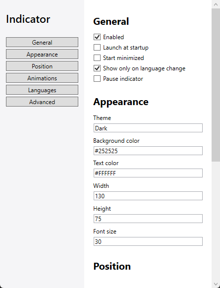

<div align="center">


# Language Switch Indicator

**Know your keyboard language. Instantly.**

A compact, macOS-inspired language popup for Windows.<br>
Switch your keyboard language and see it clearly, right where you need it.

<p>
  
  
  
</p>

**[↓ Download for Windows](https://github.com/ahmadessawii06/LanguageSwitchIndicator/releases/latest)** · [Quick start](#quick-start) · [Build from source](#build-from-source)


<sub>A clear signal every time you switch. English, Arabic, and your other keyboard languages.</sub>

</div>

## Small popup. Thoughtful details.

| | |
| :--- | :--- |
| **⌨️ Instant feedback** — see the active language when you switch. | **✨ Smooth motion** — four animation presets with adjustable timing. |
| **📍 Your preferred position** — center, corners, or near your cursor. | **◐ Adaptive tray icon** — stays visible in light and dark Windows themes. |

<details>
<summary><strong>⚙️ Take a look at the settings</strong></summary>

Adjust popup size, font size, position, and animation timing. Preview your changes from settings or the tray menu.

<p align="center">
  
</p>

</details>

## Quick start

1. Download the ZIP from **[Releases](https://github.com/ahmadessawii06/LanguageSwitchIndicator/releases/latest)** and extract all files.
2. Run `LanguageSwitchIndicator.exe`.
3. Switch your keyboard language to see the popup.

Right-click the icon beside the clock to open settings, preview the popup, toggle the indicator, or exit. Check the **↑ hidden icons** menu if needed.

**Requires:** Windows 10/11 and [.NET Desktop Runtime 8](https://dotnet.microsoft.com/en-us/download/dotnet/8.0).

## Build from source

With the **.NET 8 SDK** installed on Windows, run from the repository folder:

```powershell
dotnet run --project LanguageSwitchIndicator.App
```
