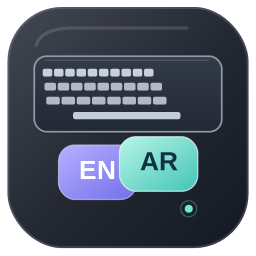
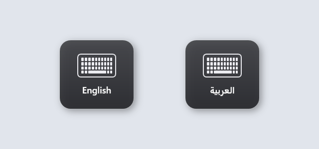

<p align="center">
  
</p>

# Language Switch Indicator

A lightweight, macOS-inspired keyboard language indicator for Windows.



Smooth animations, four ready-made animation presets, and system tray controls. Built with C# and WPF.

## Download

Get the ZIP from [Releases](https://github.com/ahmadessawii06/LanguageSwitchIndicator/releases/latest), extract all files, and run `LanguageSwitchIndicator.exe`.

Requires Windows 10/11 and [.NET Desktop Runtime 8](https://dotnet.microsoft.com/en-us/download/dotnet/8.0).

Switch your keyboard language to see the indicator. Right-click the tray icon to open settings or exit.

## Build

```powershell
dotnet run --project LanguageSwitchIndicator.App
```

Requires the .NET 8 SDK on Windows.
