<h1>
  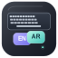
  Language Switch Indicator
</h1>

**A little clarity with every language switch.**<br>
A macOS-inspired keyboard language indicator and instant typing correction utility for Windows 10 and 11. Follows the active screen and caret where you type.

<p>
  
  
  
  
</p>

[**Download for Windows ↗**](https://github.com/ahmadessawii06/LanguageSwitchIndicator/releases/latest) · [Quick Start](#quick-start) · [Settings](#settings) · [Typing Correction](#6-typing-correction) · [Build from Source](#build-from-source)

---

## Highlights

- **Multi-Monitor Awareness:** Shows the popup on the exact monitor where you are actively typing.
- **Bidirectional Typing Correction:** Converts misplaced text between English (US) and Arabic (101) layouts with a single keystroke (default `F8` or custom hotkey).
- **macOS-Inspired Design:** Floating, beautifully animated indicator with keyboard glyph and language label.
- **Fluent Design Settings:** Clean, responsive settings interface built with WPF-UI, with real-time preview and instant auto-save.
- **Zero Clipboard Pollution:** Corrections directly replace text in foreground controls without corrupting the Windows clipboard.
- **Accessible & Customizable:** 5 sizing presets, Dark / Light / System themes, customizable positioning, and animation timings.

---

## Themes & Sizes

### Dark or Light

Choose **Dark**, **Light**, or **System** to seamlessly match your Windows mode. Changes preview immediately and save automatically.

<p align="center">
  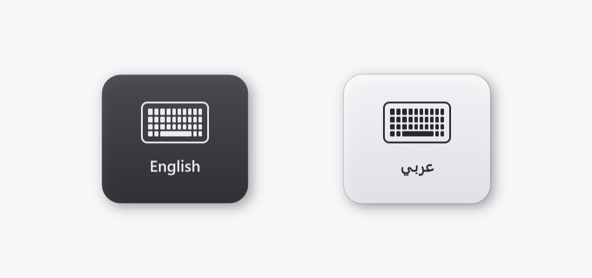
</p>

### Five Indicator Sizes

Pick the ideal size in **Settings → Appearance**. The keyboard icon, typography, and container scale harmoniously together.

<p align="center">
  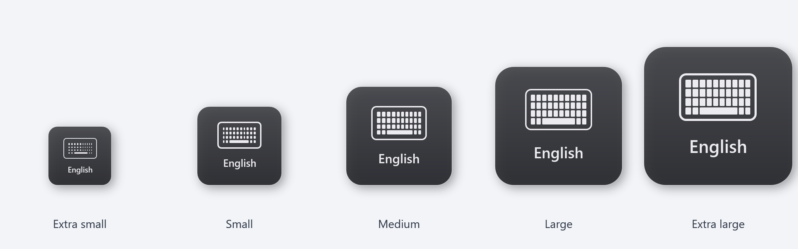
</p>

---

## Settings

The settings interface is organized into **8 dedicated sections**, built with Fluent Design:

### 1. General

Control the indicator lifecycle, trigger behavior, and startup preferences.

- **Enable / Pause:** Toggle the indicator or pause it temporarily while keeping your saved preferences.
- **Popup Trigger Mode:** Show when the keyboard language changes, when you click/place the caret in a text field, or both.
- **Launch with Windows:** Automatically start with Windows without requiring administrator privileges.
- **Start in the Tray:** Launch silently in the notification area beside the clock.

<p align="center">
  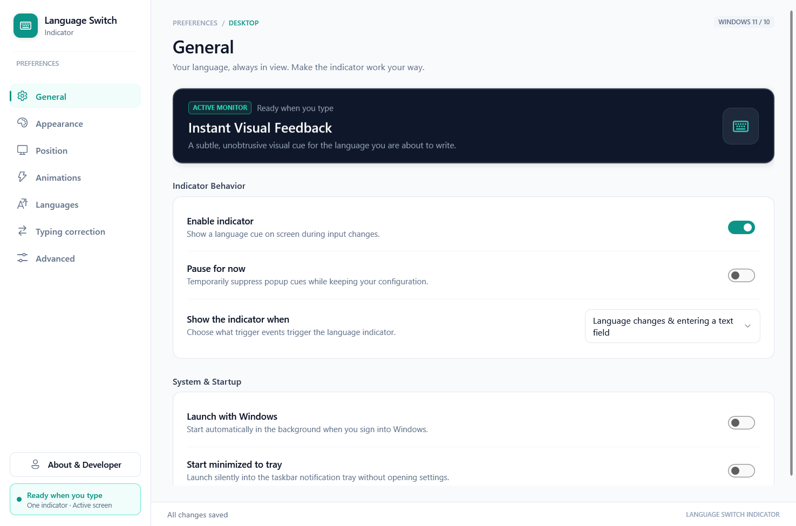
</p>

---

### 2. Appearance

Fine-tune the visual look and feel with an interactive live preview.

- **5 Sizes:** Extra small, Small, Medium, Large, and Extra large.
- **Theme Selection:** Dark, Light, or follow Windows System theme.
- **Custom Dimensions:** Custom width, height, font size, and corner radius.
- **Live Preview:** Immediate feedback with an interactive switch button to test English and Arabic layouts.

<p align="center">
  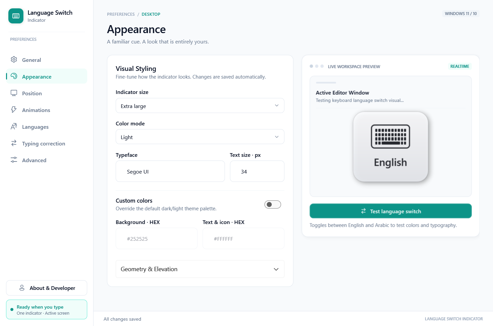
</p>

---

### 3. Position

Place clarity exactly where you need it across single or multi-monitor setups.

- **9-Point Placement Grid:** Center, Top Center, Bottom Center, Corners (Top Left, Top Right, Bottom Left, Bottom Right).
- **Beside the Text Caret:** Dynamically places the indicator right next to where your text cursor is located.
- **Custom Pixel Offsets:** Fine-tune the exact horizontal and vertical offset from the top-left screen edge.

<p align="center">
  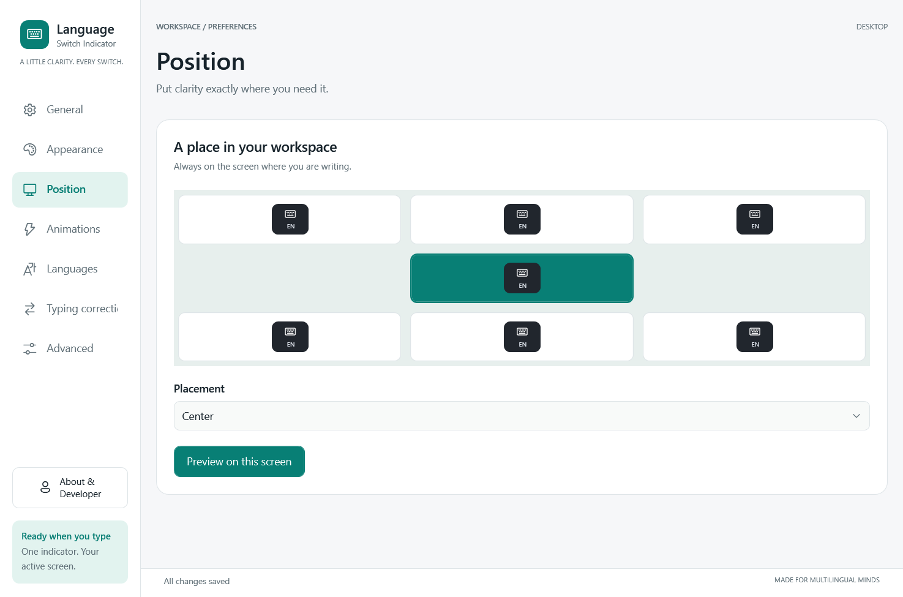
</p>

---

### 4. Animations

Smooth entrance and exit animations tailored to your workflow.

- **Timing Presets:** *Keyboard* (rapid), *Very Fast*, *Natural*, or *Slow*.
- **Custom Durations:** Adjust display duration, fade-in speed, and fade-out speed in milliseconds.
- **Animation Styles:** Fade, Fade & Scale, Slide Up, Slide Down, or Instant.
- **Reduce Motion:** Honors Windows system accessibility and reduced motion settings.

<p align="center">
  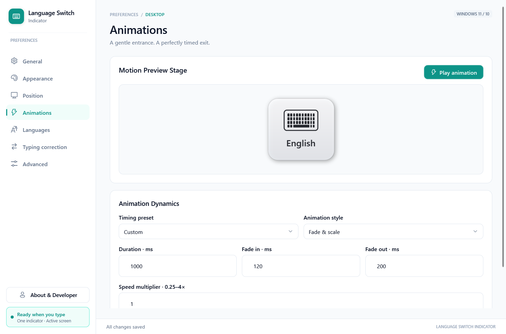
</p>

---

### 5. Languages

Manage detected keyboard layouts and customize language display names.

- **Automatic Layout Detection:** Automatically identifies your active Windows input layouts (e.g. English US, Arabic 101).
- **Custom Display Labels:** Override default names with your preferred label (e.g., `عربي` instead of `AR`).

<p align="center">
  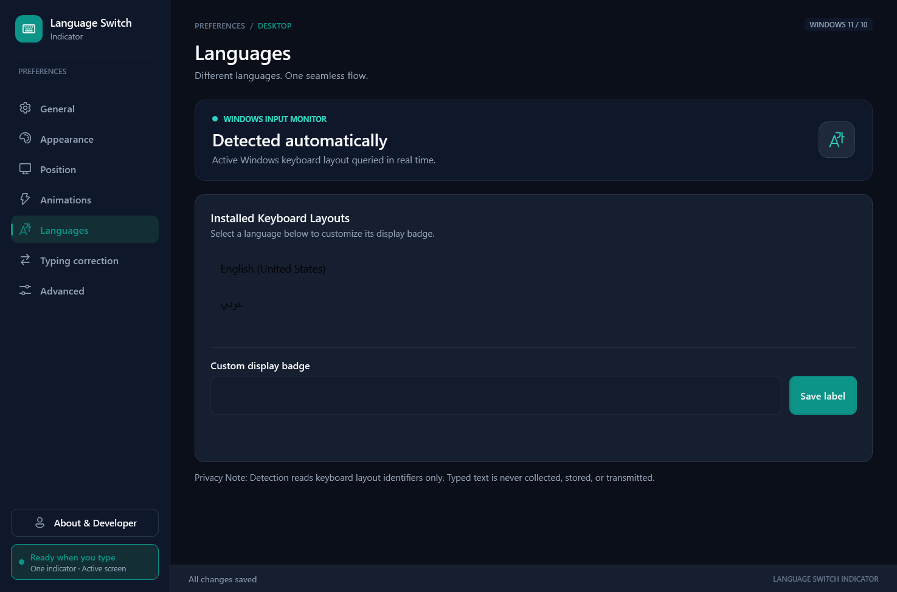
</p>

---

### 6. Typing Correction

Instantly fix text typed in the wrong keyboard layout without retyping.

- **Bidirectional Conversion:** Translates text between English (US) ↔ Arabic (101), handling ligatures (`لا`, `لإ`, `لأ`, `لآ`), punctuation, and numerals.
- **Configurable Global Hotkey:** Easy-to-use shortcut recorder with visual feedback.
  - Supports single function keys (`F8`, `F9`, `F10`, `F12`).
  - Supports two-key combinations (`Ctrl+Q`, `Alt+Q`, `Shift+F8`, `Ctrl+Space`).
  - Supports three-key combinations (`Ctrl+Alt+Q`, `Ctrl+Shift+K`).
  - Rejects unsafe and operating-system-reserved shortcuts.
- **Zero Clipboard Pollution:** Replaces the word directly in the active control (Notepad, WordPad, Win32, WPF, and browser inputs).
- **Interactive Test Area:** Built-in sandbox field to test and verify typing correction live inside Settings.

<p align="center">
  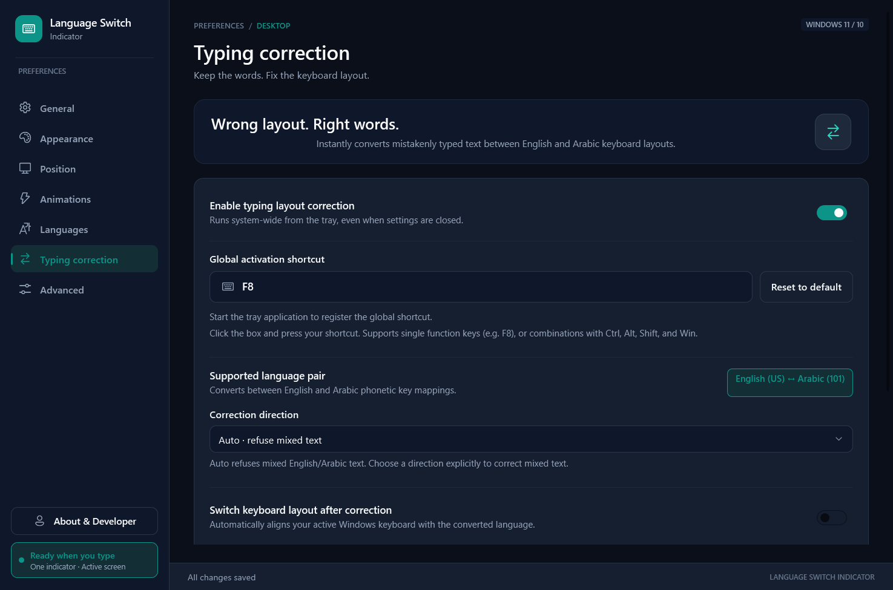
</p>

---

### 7. Advanced

Fine-tuning, diagnostics, and developer inspection tools.

- **Language Variants:** Option to trigger the popup on regional keyboard variant switches.
- **Focus Changes:** Allow caret activation when switching focus between text fields.
- **7-Stage Diagnostic Logging:** Records execution pipeline diagnostics (hotkey received, foreground HWND, target edit control, captured text, converted string, replacement, caret restore) without recording personal data.
- **Open Data Folder:** One-click shortcut to local application data in `%LOCALAPPDATA%\LanguageSwitchIndicator`.

<p align="center">
  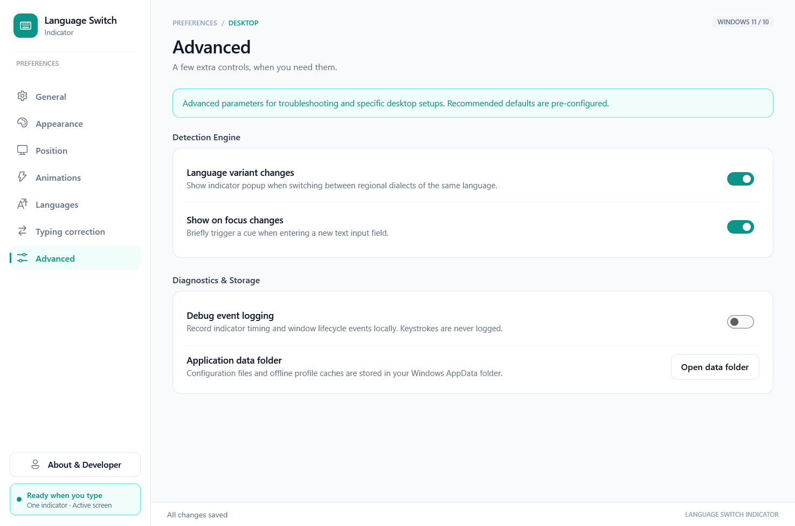
</p>

---

### 8. About the Developer

A modern developer card showcasing the creator behind the project.

- **GitHub Profile Integration:** Live developer profile for **Ahmad Essawii** ([@ahmadessawii06](https://github.com/ahmadessawii06)).
- **Interactive Metrics:** Live public repository count, followers, and following fetched directly from GitHub API.
- **Offline Resilience:** Local profile and avatar cache for instant 0ms load times and seamless offline use.
- **Project Repository Links:** Direct access to source code, releases, and issue tracking.

<p align="center">
  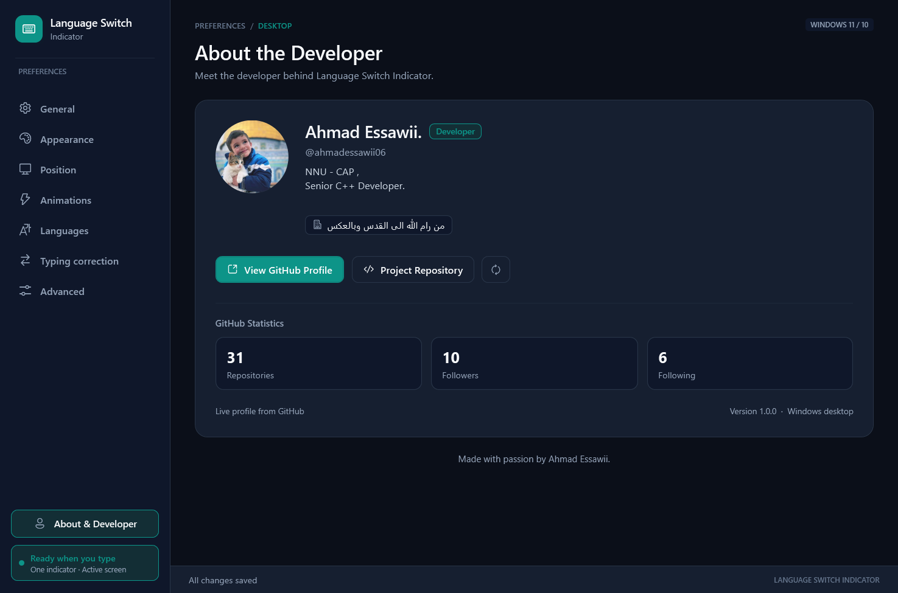
</p>

---

## Quick Start

1. Download the latest release from [Releases](https://github.com/ahmadessawii06/LanguageSwitchIndicator/releases/latest).
2. Extract the ZIP and run `LanguageSwitchIndicator.exe`.
3. Switch your keyboard language (e.g. `Alt+Shift` or `Win+Space`) or press `F8` to correct typed words.
4. Right-click the keyboard icon in the taskbar notification tray to open **Settings**, trigger a preview, or exit.

> **Requirements:** Windows 10 or 11, and [.NET Desktop Runtime 8.0](https://dotnet.microsoft.com/en-us/download/dotnet/8.0).

---

## Build from Source

Requires **.NET 8 SDK** on Windows:

```powershell
# Clone the repository
git clone https://github.com/ahmadessawii06/LanguageSwitchIndicator.git
cd LanguageSwitchIndicator

# Run the application
dotnet run --project LanguageSwitchIndicator.App

# Run the automated test suite (86 tests)
dotnet test LanguageSwitchIndicator.Tests

# Run the visual design review & docs export tool
dotnet run --project tools/DesignReview -- tmp/design-review --export-docs
```

---

## License

This project is licensed under the [MIT License](LICENSE). Third-party notices and licenses for WPF-UI and bundled icons are included in the `Licenses/` directory.

---

<p align="center">
  <sub>Made with passion by <b>Ahmad Essawii</b> · <a href="https://github.com/ahmadessawii06">@ahmadessawii06</a></sub>
</p>
