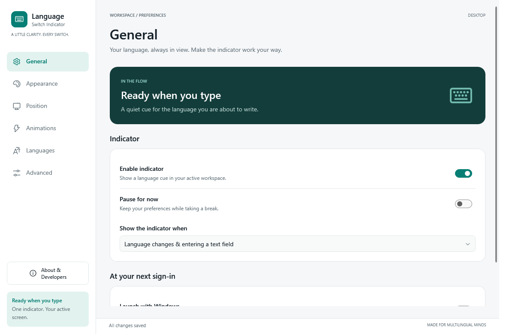
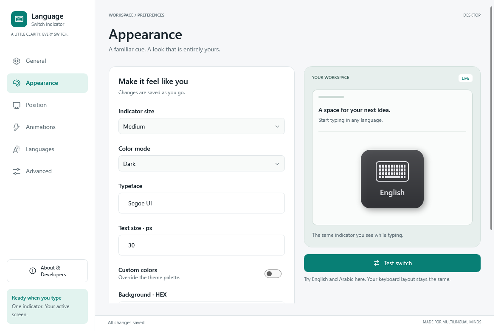
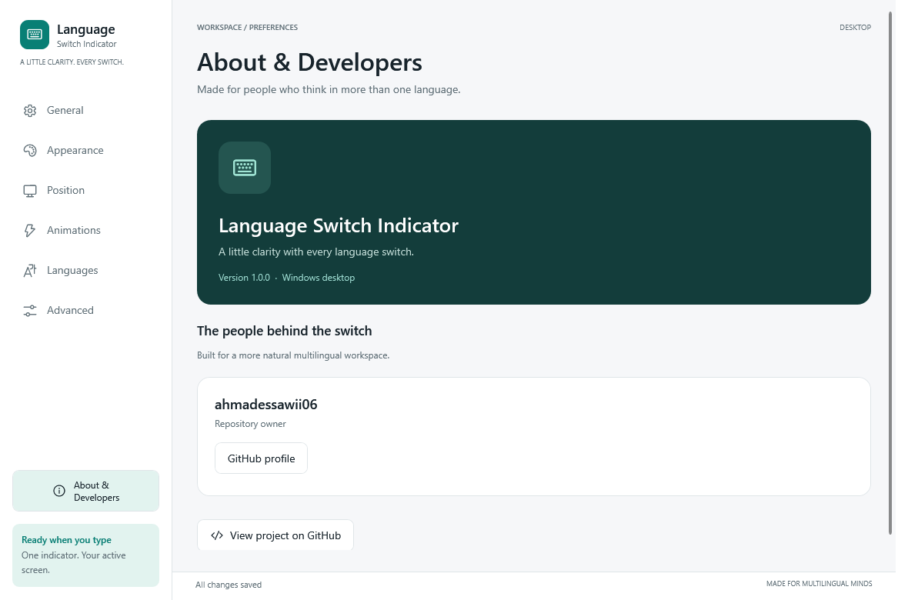

# Desktop redesign

The actual WPF settings window uses [shared XAML resources](../../LanguageSwitchIndicator.App/Themes/Product.xaml), WPF-UI 4.3.0 switches and Fluent System Icons, and a teal accent. All seven pages share the same shell. Appearance rearranges its editor and preview below 1080 DIP.

## Reviewed screens

| General | Appearance | About & Developers |
| --- | --- | --- |
|  |  |  |
| [620 DIP](general-narrow.png) | [620 DIP](appearance-narrow.png) | [620 DIP](about-narrow.png) |

## Implementation

- [SettingsWindow.xaml](../../LanguageSwitchIndicator.App/Views/SettingsWindow.xaml): actual pages and responsive shell.
- [SettingsEditor.cs](../../LanguageSwitchIndicator.App/Models/SettingsEditor.cs): validated bindings and immediate persistence. Existing settings fields and enum values are preserved; new fields have backwards-compatible defaults.
- [IndicatorView.xaml](../../LanguageSwitchIndicator.App/Views/IndicatorView.xaml): shared rendering for the real popup and inline previews. Test switch changes only the preview example. Animation previews respect reduced motion and Windows animation preferences.
- [developers.json](../../LanguageSwitchIndicator.App/developers.json): edit developer names, roles, GitHub profiles, and optional websites here. The only initial profile is the repository owner's verified GitHub username; no personal name is inferred. An empty array shows the designed empty state. Links require an absolute HTTPS URL and open in the default browser.
- [StartupService.cs](../../LanguageSwitchIndicator.App/Services/StartupService.cs): the startup switch updates the current user's Windows Run entry. No administrator privileges are needed.
- WPF-UI and bundled icon notices are shipped in the application's Licenses directory.

## Verification

- Release build and **16 passing automated tests**: legacy JSON loading, validated edits, saving and reopening, all five popup sizes, light/dark palettes, popup lifetime and renewal, regional layout identifiers, and embedded tray icons.
- Ran the real Release application through the included VS Code task. Also opened the actual settings window in the review harness; created and disposed a real NotifyIcon; displayed and dismissed a real popup.
- Rendered all seven pages at 1180, 700, and 620 DIP. Reviewed General, Appearance, About, Position, Animations, Languages, and Advanced; checked scrolling to the bottom at minimum width.
- Exercised bound numeric input, rejection of invalid input without overwriting the last valid value, dropdown selection, keyboard focus traversal, and isolation of inline Test switch from system popups. No binding errors were recorded.
- Captured 120 and 144 DPI renders (125% and 150%) of General, Appearance, and About. These are raster rendering checks, **not** a change to the operating system's actual display scale.
- **Not verified:** physical multi-monitor movement, real English/Arabic keyboard switching in an external application, default-browser launching, and an actual Windows sign-in. The external typing fixture could not receive foreground events: `GetForegroundWindow()` returned zero in this execution desktop.

## Repeat the visual checks

From the repository root on Windows:

```powershell
dotnet run --project tools/DesignReview -- tmp/design-review --live
```

The harness uses a separate settings file and closes its own review windows. Add `--typing-check` for the optional external English/Arabic fixture on an interactive desktop; it skips explicitly when no foreground window is exposed. Generated output is temporary and should not be committed.
